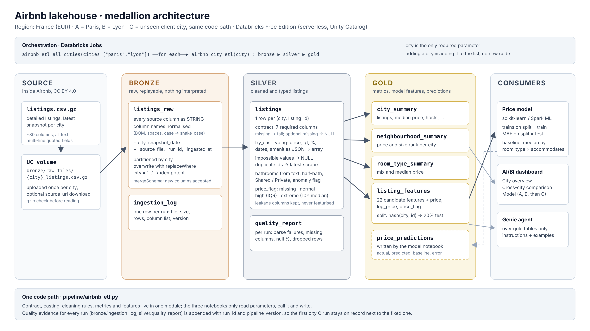

# Airbnb Lakehouse Analytics

Group Assignment 2 — Big Data

## Project Overview
Airbnb data analytics using Databricks.

## Objectives
- Exploratory Data Analysis
- Bronze, Silver, Gold lakehouse architecture
- ETL pipeline
- Price prediction model
- AI/BI dashboard
- Genie Agent
- Evaluation on an unseen city

## Region and cities

Region **France**, currency **EUR**. Data: [Inside Airbnb](https://insideairbnb.com/get-the-data/) detailed `listings.csv.gz` (CC BY 4.0).

| Role | City | `city` parameter | Snapshot date |
|---|---|---|---|
| A (training) | Paris | `paris` | 2026-09-16 |
| B (training) | Lyon | `lyon` | 2026-09-17 |
| C (new client) | Bordeaux | `bordeaux` | 2026-09-17 |

## Architecture

Medallion lakehouse in Unity Catalog `airbnb_lakehouse`: raw files in **bronze**, cleaned and typed listings in **silver**, metrics, model features and predictions in **gold**. Details, table contracts and design decisions: [docs/architecture.md](docs/architecture.md).



## ETL pipeline

One pipeline, the city is a parameter. All logic is in `pipeline/airbnb_etl.py`; the notebooks `01_bronze_ingest` → `02_silver_listings` → `03_gold_tables` are the job tasks.

| Job | What it does |
|---|---|
| `airbnb_city_etl` | bronze → silver → gold for one `city` |
| `airbnb_etl_all_cities` | runs `airbnb_city_etl` for each city in `cities` (default `["paris", "lyon"]`) |

Run it:

1. Upload each city's file to `/Volumes/airbnb_lakehouse/bronze/raw_files/<city>_listings.csv.gz`.
2. `databricks bundle deploy`, then `databricks bundle run airbnb_etl_all_cities` (or create the jobs in the UI as described in [docs/architecture.md](docs/architecture.md#jobs)).
3. `pipeline/04_run_report` shows what each run produced.

Adding a city means uploading its file and adding its name to `cities`; no code is copied.

## City C (Bordeaux)

Full report: [docs/city_c.md](docs/city_c.md). It covers the first run, the change log (each change marked as a pipeline fix or a model change) and the explanation of the gap.

| MAE (EUR), held-out listings | Baseline | v1 (`france_v1`, week 1) | v2 (`france_v2`, week 2) |
|---|---:|---:|---:|
| Paris test (8,734) | 156.65 | 142.55 | 109.89 |
| Lyon test (997) | 104.61 | 157.94 | 38.45 |
| Paris + Lyon test (9,731) | 151.32 | 144.13 | 102.57 |
| Bordeaux, first run, all 7,722 priced listings | 118.51 | **223.16** | – |
| Bordeaux test split (1,583), no Bordeaux prices used | 114.78 | 234.00* | 133.12 |
| Bordeaux test split (1,583), calibrated with Bordeaux's median price | 114.78 | 234.00* | **48.21** |

All numbers are from Databricks (`gold.model_metrics`). \* The `france_v1` model scored on the same 1,583 Bordeaux test listings as v2, computed with a SQL join of the two runs' rows in `gold.price_predictions`.

* **The ETL ran on Bordeaux without an error, but it was not correct.** Two model features (`host_years`, `instant_bookable`) had been 100% NULL in every city since week 1, because Inside Airbnb moved `host_since` to `hosts_time_as_host_years`. The quality report did not catch it.
* **The week-1 run completed with full coverage:** all 12,063 Bordeaux listings got a non-null prediction, confirmed by a Gold query. Coverage was not the problem; accuracy was.
* **The week-1 model overpriced 97% of Bordeaux listings.** Paris is 90% of the training data and twice as expensive, and the model was fitted on raw prices up to €100k.
* **v2 fixes the pipeline (P1–P3) and changes the model (M1–M4):** log price relative to the city's price level, transferable features. It beats the baseline in every city. The price level of a new city cannot be learned from Paris and Lyon alone: without a calibration sample of Bordeaux prices, v2 still loses to the baseline.

## Price prediction

Model code: `model/price_model.py`; notebook: `notebooks/02_price_prediction.py` (also the bundle job `price_model`). Feature rationale and evaluation rules: [docs/model_evaluation_report.md](docs/model_evaluation_report.md).

### Running week 2 (`france_v2`)

1. Rerun the ETL with the fixed pipeline for all three cities: `airbnb_etl_all_cities` with `cities=["paris","lyon","bordeaux"]` and `pipeline_version=week2-fix1`. Check `pipeline/04_run_report`: `empty_columns` should list `host_since` and `instant_bookable`, and `host_years` should be about 0% NULL.
2. Run the model notebook (or the `price_model` job) with `mode=train_ab`, `run_id=france_v2`.
3. Run it again with `mode=evaluate_c`, `run_id=france_v2`, `c_city=bordeaux`, `reference_run_id=france_v1`. This writes the calibrated, uncalibrated and v1-on-the-same-rows metrics to `gold.model_metrics`. The notebook asserts that every Bordeaux listing gets a prediction, then refreshes the views in `model/gold_views.sql`.
4. Read the results with `SELECT * FROM airbnb_lakehouse.gold.v_model_metrics`. (Done for this submission: the README, `docs/city_c.md` and the slides show the Databricks values.)

Never rerun `france_v1`: its first-run Bordeaux result is the evidence. The notebook refuses to overwrite it.

## Dashboard and Genie

* **AI/BI dashboard:** `dashboards/airbnb_france.lvdash.json`, generated by `dashboards/make_dashboard.py` and deployed with the bundle (`databricks bundle deploy`). It has three pages, each titled with a finding: City overview, Cross-city comparison, Model (v1 vs v2 vs baseline, including Bordeaux). The JSON has not been opened in a workspace yet. If a widget does not render, fix it in the UI and re-export it over the file.
* **Genie Agent:** configuration, instructions, certified SQL and expected answers are in [docs/genie.md](docs/genie.md).

## Presentation

Slides: [Airbnb France: Paris, Lyon, Bordeaux](https://claude.ai/artifact/2nrrnXvBXZZxczzSHcEddm) (it can be downloaded as PDF or PPTX).

## Repository

```
notebooks/01_exploratory_analysis.py   EDA on Paris and Lyon (Databricks source format)
notebooks/02_price_prediction.py       A/B training and frozen city C evaluation
model/price_model.py                   v2 model (scores v1 artifacts too) and training-only baseline
model/gold_views.sql                   dashboard/Genie views and table comments
model/dashboard_queries.sql            ad-hoc model queries
pipeline/airbnb_etl.py                 shared ETL module
pipeline/01_bronze_ingest.py           job task 1
pipeline/02_silver_listings.py         job task 2
pipeline/03_gold_tables.py             job task 3
pipeline/04_run_report.py              read-only run report
dashboards/                            AI/BI dashboard JSON and its generator
resources/                             job and dashboard definitions
databricks.yml                         Databricks Asset Bundle root
docs/architecture.md                   architecture and table contracts
docs/city_c.md                         city C report: first run, change log, gap
docs/model_evaluation_report.md        model evaluation (v1 and v2)
docs/genie.md                          Genie Agent configuration
```
