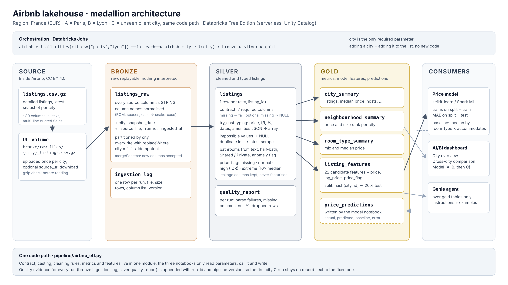
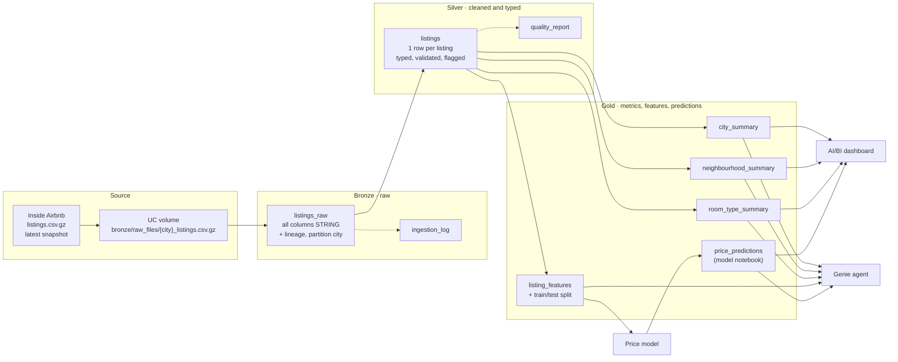

# Solution architecture



The lakehouse lives in the Unity Catalog catalog `airbnb_lakehouse` with one schema per layer. One Databricks Job runs the same three notebooks for any city; the city is a job parameter.



## Layers

| Layer | Purpose | Tables | Write mode |
|---|---|---|---|
| Bronze | Keep the file exactly as received, so any later rule can be replayed without downloading again | `listings_raw`, `ingestion_log` | `listings_raw`: overwrite the city partition (`replaceWhere city = …`, `mergeSchema`). Log: append |
| Silver | One clean, typed row per listing; every rule from the EDA applied once, here | `listings`, `quality_report` | `listings`: overwrite the city partition. Report: append |
| Gold | What people and the model consume: metrics per city / neighbourhood / room type, model features with a fixed split, predictions | `city_summary`, `neighbourhood_summary`, `room_type_summary`, `listing_features`, `price_predictions` | overwrite the city partition; `price_predictions` is owned by the model notebook |

All partitioned tables are partitioned by `city`. A run for one city never touches another city's rows, so cities can be re-run independently and in any order.

## Pipeline

```
pipeline/
├── airbnb_etl.py            shared module: contract, casting, cleaning, metrics, features
├── 01_bronze_ingest.py      file → bronze.listings_raw, bronze.ingestion_log
├── 02_silver_listings.py    bronze → silver.listings, silver.quality_report
└── 03_gold_tables.py        silver → gold.*_summary, gold.listing_features
resources/airbnb_etl.job.yml  job definitions (Databricks Asset Bundle)
databricks.yml                bundle root
```

The notebooks only read parameters, call the module and write. Nothing in them is specific to Paris or Lyon.

### Parameters

| Parameter | Required | Default | Notes |
|---|---|---|---|
| `city` | yes | `paris` | any name; normalised to a slug (`Pays Basque` → `pays_basque`) |
| `snapshot_date` | no | date in the most common `scrape_id`, else the most common `last_scraped` | set it to the date from the Inside Airbnb page to be explicit |
| `source_url` | no | — | used only if the file is not in the volume; Free Edition restricts outbound internet, so uploading is the default |
| `pipeline_version` | no | `week1` | written to both logs; lets the first city C run be told apart from the fixed one |
| `run_id` | no | `{{job.run_id}}` | filled by the job |

### Jobs

* `airbnb_city_etl(city)` — tasks `bronze → silver → gold`.
* `airbnb_etl_all_cities(cities)` — a *For each* task over `["paris", "lyon"]` that runs `airbnb_city_etl` once per city, one at a time (`concurrency: 1`). Free Edition allows 5 concurrent job tasks per account; `concurrency: 2` also fits (1 loop + 2 child runs + 2 notebook tasks).

Deploy with the Databricks CLI from the repository root:

```bash
databricks bundle validate
databricks bundle deploy
databricks bundle run airbnb_etl_all_cities
databricks bundle run airbnb_city_etl --params city=lyon
```

Or create them in the UI (*Jobs & Pipelines → Create job*):

1. Job `airbnb_city_etl`: three Notebook tasks pointing at `pipeline/01_bronze_ingest`, `02_silver_listings`, `03_gold_tables`, each depending on the previous one, compute *Serverless*. Job parameters: `city`, `snapshot_date`, `source_url`, `pipeline_version`. Task parameter `run_id` = `{{job.run_id}}`.
2. Job `airbnb_etl_all_cities`: job parameter `cities` = `["paris", "lyon"]`; one *For each* task with inputs `{{job.parameters.cities}}`, concurrency 1, nested task *Run Job* → `airbnb_city_etl` with job parameter `city` = `{{input}}`.

## Design decisions

| Decision | Reason |
|---|---|
| Bronze stores every column as a string | The file is never rejected for a type problem; typing errors surface in silver where they are counted |
| Column names normalised in bronze (BOM, spaces, case) | Delta does not accept some characters in column names; the values are untouched |
| Silver uses `try_cast` for every typed column | Serverless runs with ANSI SQL on, where a plain `CAST` fails the whole run on one bad value |
| Values that do not parse are counted per column in `silver.quality_report` | A NULL produced by a parse error is visible, not silent |
| Required vs optional columns | Missing `id`, `price`, `room_type`, `accommodates`, `neighbourhood_cleansed`, `latitude`, `longitude` stops the run with a clear message; any other missing column becomes NULL and is listed in the report |
| Outliers flagged (`price_flag`), not deleted | The decision what to train on belongs to the model; the dashboard can still show them |
| Train/test split stored in `gold.listing_features` | `hash(city, listing_id) mod 100 < 20` → test. The same listings are test on every re-run, before any model choice |
| Leakage columns stop at silver | `estimated_revenue_l365d` is price × occupancy; `price_quote_*` is a price quote for a stay. They stay in silver for analysis and are never in `listing_features` |
| `dist_to_center_km` uses the median coordinates of the city's own listings | No hard-coded city centre, so the feature exists for any new city |
| Every run is logged with `run_id` and `pipeline_version` | The week-1 run on city C stays on record after the fixes |

## Table contracts

### `silver.listings`

`listing_id BIGINT` · `city` · `city_name` · `snapshot_date DATE` · typed source columns from `SILVER_CONTRACT` in `airbnb_etl.py` · derived: `bathroom_type`, `bathroom_anomaly`, `amenities_count`, `has_price`, `price_flag` (`missing` / `normal` / `high` / `extreme`).

### `gold.listing_features`

| Column group | Columns |
|---|---|
| Keys | `city`, `city_name`, `listing_id`, `snapshot_date`, `name`, `listing_url` |
| Categorical | `room_type`, `property_type`, `neighbourhood`, `bathroom_type` |
| Numeric | `accommodates`, `bedrooms`, `beds`, `bathrooms`, `amenities_count`, `minimum_nights`, `availability_365`, `number_of_reviews`, `number_of_reviews_ltm`, `review_scores_rating`, `review_scores_location`, `host_is_superhost`, `host_listings_count`, `host_years`, `instant_bookable`, `latitude`, `longitude`, `dist_to_center_km` |
| Target | `price` (EUR per night), `log_price` = `log1p(price)`, `price_flag`, `has_price` |
| Split | `split` = `train` / `test` |

### `gold.price_predictions` (written by the model notebook)

Suggested columns, so the dashboard and Genie can be built in parallel:

`city`, `listing_id`, `split`, `room_type`, `accommodates`, `neighbourhood`, `price` (actual, NULL if unpriced), `predicted_price`, `baseline_price`, `error` (= predicted − actual), `abs_error`, `model_name`, `model_version`, `scored_at`.
